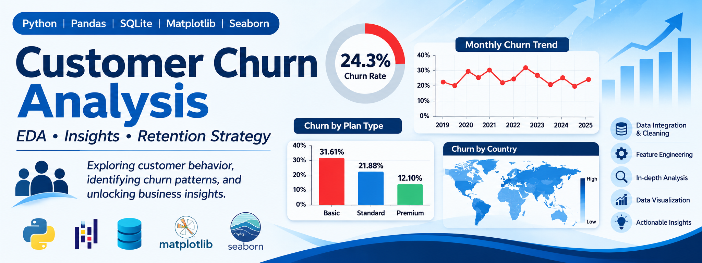

# 📊 Customer Churn Analysis and Customer Intelligence

<p align="center">
  <!-- আপনি চাইলে এখানে আপনার প্রজেক্টের একটি ব্যানার ইমেজ যোগ করতে পারেন -->
   
  
</p>

<p align="center">


</p>

---

# 📌 Project Overview

Customer churn is one of the most critical metrics for subscription-based businesses. Understanding why customers leave and identifying high-risk segments is essential for sustainable growth.

This project performs an end-to-end **Exploratory Data Analysis (EDA)** on customer churn data using **Python, Pandas, SQLite, Matplotlib, and Seaborn**. The workflow begins by importing raw Excel data into an SQLite database, extracting it back to Pandas, cleaning and merging the datasets, and finally generating business-focused insights through feature engineering and visualizations.

---

# 🎯 Project Objectives

- Integrate data from multiple tables (Customer, Subscription, Support) using SQLite and Pandas.
- Perform comprehensive data cleaning and standardization.
- Engineer new features to better understand customer behavior and tenure.
- Calculate key business KPIs such as Churn Rate, ARPU, and Revenue at Risk.
- Identify churn patterns based on plan types, subscription types, and geography.
- Visualize data using Matplotlib and Seaborn to communicate insights effectively.

---

# 📂 Dataset Information

The project uses three distinct raw datasets imported from Excel and stored in SQLite:

1. **`db_customer`**: Customer demographics (ID, Name, Country, State, Gender, DOB).
2. **`db_subscription`**: Subscription details (Plan Type, Contract Type, Monthly Charges, CLTV, Churn Score, Dates).
3. **`db_support`**: Customer support interactions (Complaint Date, Escalations, CSAT Score, Comments).

**Final Merged Dataset:** 
After merging based on `Customerid`, the final analytical dataset contains **650,000 rows** and **21 columns**.

---

# 🛠️ Tools & Technologies

| Category | Tools |
|----------|-------|
| Programming Language | Python |
| IDE | Jupyter Notebook |
| Database | SQLite |
| Libraries | Pandas, NumPy, SQLite3 |
| Visualization | Matplotlib, Seaborn |
| Version Control | Git |
| Repository Hosting | GitHub |

---

# 📋 Project Workflow

## 1️⃣ Data Collection & Ingestion
- Imported 3 Excel sheets into an SQLite database (`customer_churn.db`).
- Read the database tables back into Pandas DataFrames using SQL queries.

## 2️⃣ Data Cleaning
- Converted date columns (`Dob`, `Subscription_Start_Date`, `Renewal_Date`, `Cancellation_Date`, `Complaint_Date`) to datetime format.
- Handled missing values by filling null `Country` values using a `State` to `Country` mapping.
- Dropped irrelevant columns (`Interests`, `Pincode`, `Col_1`, `Comment`).
- Standardized categorical values (e.g., replacing 'Men'/'Women' with 'Male'/'Female').

## 3️⃣ Feature Engineering
- **`Churn_flag`**: Created a binary flag (1 for churned, 0 for retained) based on `Cancellation_Date`.
- **`Customer_age`**: Calculated from the `Dob` column.
- **`tenure_days`**: Calculated the total active days for each customer.
- **`Churn_risk`**: Categorized customers into Low, Medium, and High risk based on `Churn_Score`.
- **`Cancellation_month`**: Extracted for monthly churn trend analysis.

## 4️⃣ Data Visualization & Analysis
- **Matplotlib**: Monthly churn trends, Churn by Plan Type, Churn by Country, and Churn by State.
- **Seaborn**: Correlation Heatmaps, Pairplots, and Categorical (Catplot) comparisons.
- **Pivot Tables**: Multi-dimensional aggregation of churn rates and revenue metrics.

---

# 📊 Key Analysis Performed

- **KPI Calculation**: Overall Churn Rate, Retention Rate, ARPU, and Revenue at Risk.
- **Churn Segmentation**: By Plan Type, Subscription Type, and State.
- **Support Analysis**: Identifying active complainers and escalation rates.
- **Correlation Analysis**: Finding relationships between churn scores, contract types, and risk levels.

---

# 📈 Key Insights

## 💰 Business KPIs
- **Churn Rate**: **24.3%** (Nearly 1 in 4 customers churned).
- **Retention Rate**: **75.7%**.
- **ARPU (Average Revenue Per User)**: **17.51**.
- **Avg Customer Tenure**: **1402.10 days**.
- **Revenue at Risk**: **2,223,747** lost from churned users.

## 📦 Plan & Subscription Behavior
- The **Basic Plan** has the highest churn rate (**31.61%**), followed by Standard (21.88%), and Premium (12.10%).
- **Organic** customers churn the most (32.43%), followed by Paid (22.09%) and Referrals (11.93%).
- *Insight: Lower-tier and casual (organic) segments are more likely to leave.*

## 🌍 Geographic Trends
- Churn varies significantly by State. Some states show extremely low churn, while others experience severe churn, indicating a need for localized retention strategies.

## 🎧 Support Interaction
- The support table contains **37,500 records** for **30,000 unique customers**, meaning some customers raised multiple complaints. Not every customer complains, which provides a realistic view of support data.

---

# 📁 Project Structure

```text
Customer-Churn-Analysis-EDA
│
├── Dataset/
│   ├── customer_churn_raw_data_final.xlsx
│   └── customer_churn.db (SQLite Database)
│
├── Notebook/
│   └── EDA_Churn_analysis.ipynb
│
├── Reports/
│   ├── Churn_analysis_Project.pdf
│   └── Workflow Summary.pdf
│
├── Images/
│   └── (Generated Charts and Plots)
│
├── README.md
└── requirements.txt
```

---

# 🚀 How to Run

### Clone Repository

```bash
git clone https://github.com/yourusername/Customer-Churn-Analysis-EDA.git
```

### Navigate

```bash
cd Customer-Churn-Analysis-EDA
```

### Install Dependencies

```bash
pip install pandas numpy matplotlib seaborn
```

### Launch Jupyter Notebook

```bash
jupyter notebook
```

Open:
```text
Notebook/EDA_Churn_analysis.ipynb
```

---

# 📚 Libraries Used

- Pandas & NumPy (Data Manipulation)
- SQLite3 (Database Management)
- Matplotlib & Seaborn (Data Visualization)

---

# 👨‍💻 Author

**Your Name**

🌐 Portfolio: [SABBIR UDDIN AKASH](https://yourportfolio.com)

💻 GitHub: [sabbirakash](https://github.com/yourusername)

💼 LinkedIn: [SABBIR UDDIN AKASH](https://www.linkedin.com/in/yourusername)

---

# ⭐ Support

If you found this project useful, please consider giving it a ⭐ on GitHub. 

Your support motivates me to build more Data Analytics, Python, SQL, Excel, and Power BI projects.
